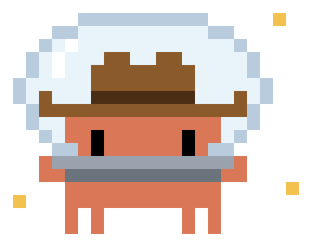

<p align="center"></p>

# claude-space-cowboy

A [Claude Code](https://claude.com/claude-code) skill that coordinates
[claude-cowboy](https://github.com/nicklausroach/claude-cowboy) agents on several machines
from one session.

claude-cowboy runs background coding agents in Herdr workspaces, each in its own Git
worktree, on the machine you're on. claude-space-cowboy lets the session on your laptop
spawn, steer, review and land those agents on remote machines too. Each agent runs on the
machine that holds its repo. The coordinator sends claude-cowboy commands there over SSH,
and the agents' Herdr workspaces appear under that machine in your Herdr sidebar.

See [`SKILL.md`](SKILL.md) for full usage.

## Requirements

- **This machine:** Claude Code, Herdr, Python 3, SSH access to each remote.
- **Every machine, this one included:** [claude-cowboy](https://github.com/nicklausroach/claude-cowboy)
  with coordinator support, Python 3.11+ (or `tomli`), Git, Claude Code (signed in) and a
  running Herdr server.
- **Each remote** is saved in Herdr: `herdr machine add --label <label> <ssh-target>`.

`space-cowboy doctor` checks all of this.

## Install

On the coordinating machine:

```bash
git clone https://github.com/nicklausroach/claude-space-cowboy ~/.claude/skills/claude-space-cowboy
```

On every machine, including the coordinator:

```bash
git clone https://github.com/nicklausroach/claude-cowboy ~/.claude/skills/claude-cowboy
```

Both skills call their helpers by literal path, so install them at exactly those
locations. Allow-rules for `~/.claude/settings.json`:

```json
{ "permissions": { "allow": [
  "Bash(~/.claude/skills/claude-space-cowboy/scripts/space-cowboy:*)",
  "Bash(~/.claude/skills/claude-cowboy/scripts/cowboy:*)"
] } }
```

Then add the claude-cowboy rule to each remote's `~/.claude/settings.json`, and open
Claude Code once in each repo you'll use there, so its folder-trust setting carries over
to agent worktrees.

### Recommended SSH settings

Several background waiters share each connection, and long waits should survive idle
periods. In `~/.ssh/config`:

```
Host devbox gpu-box
  ControlMaster auto
  ControlPath ~/.ssh/cm-%C
  ControlPersist 10m
  ServerAliveInterval 30
```

## Usage

Start Claude Code inside a Herdr pane on your laptop and hand it a job:

```
/claude-space-cowboy add input validation to the API on devbox, and the matching training-data checks in the ML repo on gpu-box
```

The helper on its own:

| Command | What it does |
| --- | --- |
| `space-cowboy machines` | List `local` plus saved Herdr machines and their configured repos |
| `space-cowboy doctor [machine…]` | Check each machine can run agents |
| `space-cowboy status [machine…]` | List agents on every machine, as `machine:id` |
| `space-cowboy on <machine> <cowboy command…>` | Run any claude-cowboy command on that machine |

`on <machine> spawn -f FILE` reads the prompt file on this machine and sends it over.
`on <machine> wait` reconnects if SSH drops, since waiting can safely be repeated.

## Configuration

`~/.claude/claude-space-cowboy/config.json` (optional) records which repos live where, so
the coordinator can route tasks without asking:

```json
{ "machines": { "devbox": { "repos": ["~/api"] } } }
```

Everything else (concurrency, models, templates, permission mode) is claude-cowboy config,
set per machine: `space-cowboy on devbox config --set agent.model=sonnet`.

## Notes

- Remote commands run in the remote user's login shell, so `PATH` matches an interactive
  session. Commands get `CLAUDE_COWBOY_COORDINATED=1` and the machine's Herdr session from
  `herdr machine list`.
- claude-cowboy runs agents with permission checks **bypassed by default**. Consider
  `space-cowboy on <machine> config --set agent.permission_mode=acceptEdits` on remotes that
  can reach sensitive systems.
- Agent reports and diffs come back into the coordinating session.
