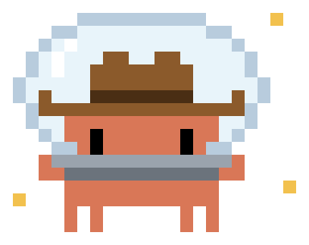

<p align="center"></p>

# claude-space-cowboy

A [Claude Code](https://claude.com/claude-code) skill that runs coding jobs in fresh
[Ona](https://ona.com) environments, driven from one Claude Code session on your laptop.

For each job, the coordinator:

1. creates an Ona environment from the repo's project (`cowboy-<job>`)
2. prepares it (Claude Code, [claude-cowboy](https://github.com/nicklausroach/claude-cowboy),
   Herdr core, gh + gh-stack, your work git email) and adds it to Herdr as a
   machine
3. runs one or more claude-cowboy agents there, each a Claude Code session in its own Git
   worktree, visible as tabs in Herdr (terminal or desktop app)
4. reviews and steers them, then (when you say so) lands their work as one PR or a
   [`gh stack`](https://github.com/github/gh-stack) of PRs, stops the environment, and
   later deletes it.

It also still drives agents on saved Herdr SSH machines (`space-cowboy on <machine> …`).

See [`SKILL.md`](SKILL.md) for the full workflow.

## Requirements

- **This machine:** Claude Code, Herdr (terminal app or desktop app), Python 3.11+, the
  [`ona` CLI](https://ona.com/docs) signed in (`ona login`) with its SSH integration
  (`ona environment ssh-config`), and
  [claude-cowboy](https://github.com/nicklausroach/claude-cowboy).
- **Ona:** a project for each repo, GitHub connected on the runner region you use
  (default Ohio), and a `CLAUDE_CODE_OAUTH_TOKEN`-providing user secret so Claude Code can
  sign in inside environments (e.g. a `DEV_CLAUDE_CODE_OAUTH_TOKEN` secret mounted as an
  env var; create one with `claude setup-token`).

Environments need nothing preinstalled: `env create` sets them up and writes no credentials.

## Install

```bash
git clone https://github.com/nicklausroach/claude-space-cowboy ~/.claude/skills/claude-space-cowboy
git clone https://github.com/nicklausroach/claude-cowboy ~/.claude/skills/claude-cowboy
```

Both skills call their helpers by literal path, so install them at exactly those
locations. Allow-rules for `~/.claude/settings.json`:

```json
{ "permissions": { "allow": [
  "Bash(~/.claude/skills/claude-space-cowboy/scripts/space-cowboy:*)",
  "Bash(~/.claude/skills/claude-cowboy/scripts/cowboy:*)"
] } }
```

## Usage

Start Claude Code inside Herdr and hand it a job:

```
/claude-space-cowboy in dbt: add not-null tests to the finance marts, one PR per mart as a stack
```

The helper on its own:

| Command | What it does |
| --- | --- |
| `space-cowboy env projects` | List Ona projects and where each repo lands in an environment |
| `space-cowboy env create <project> --name <job>` | Create, prepare and add a `cowboy-<job>` environment to Herdr |
| `space-cowboy env list` | Environments made here and their Ona phase |
| `space-cowboy env setup <machine>` | Repeat preparation and re-add to Herdr (safe to repeat) |
| `space-cowboy env stop` / `start <machine>` | Stop (keeps the disk) or resume an environment |
| `space-cowboy env delete <machine>` | Delete the environment and its Herdr machine |
| `space-cowboy on <machine> <cowboy command…>` | Run any claude-cowboy command there (`spawn`, `wait`, `diff`, `steer`, …) |
| `space-cowboy status [machine…]` | Agents on every machine, as `machine:id` |
| `space-cowboy machines` / `doctor [machine…]` | List machines; check agents can run there |

## Configuration

`~/.claude/claude-space-cowboy/config.json` (optional):

```json
{
  "ona": { "region": "Ohio", "inactivity_timeout": "4h", "projects": { "ac": "Analytics Cluster" } },
  "machines": { "devbox": { "repos": ["~/api"] } }
}
```

Agent settings (concurrency, models, templates, permission mode) are claude-cowboy
config, per machine: `space-cowboy on <machine> config --set agent.model=sonnet`.

## Notes

- Ona sends an environment to a project's first environment class unless told otherwise,
  and that class's runner may not have your GitHub sign-in. `env create` picks the
  project's class in the configured region instead.
- claude-cowboy runs agents with permission checks **bypassed by default**. Each
  environment is a fresh, single-purpose sandbox, but it can push to your repos.
- `gh` in an environment is a wrapper that borrows git's Ona-provided GitHub credential on
  each call; nothing is stored. Claude Code signs in from `CLAUDE_CODE_OAUTH_TOKEN`.
- Agent reports and diffs come back into the coordinating session.
